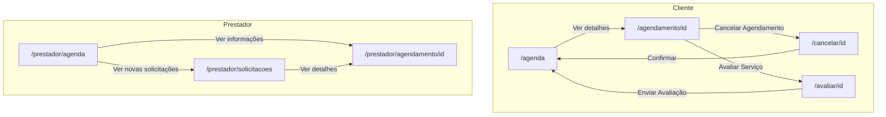
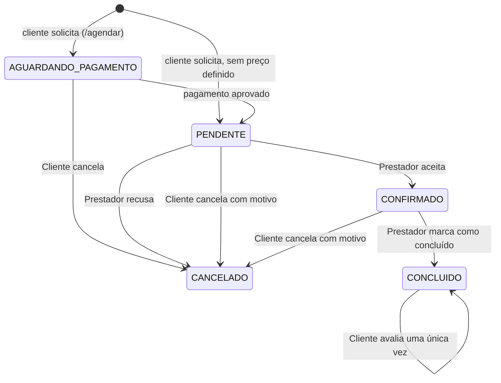

# Agenda — documentação do módulo

> Documentação do módulo de **agendamentos** do app Nesha (front-end Expo + React Native).
> Cobre as telas do **Cliente** e do **Prestador**, o modelo de dados, as regras de negócio já
> implementadas, as limitações atuais e a proposta de integração com o backend.
>
> **Estado atual:** integrado ao backend. Os agendamentos vêm de `/api/v1/agendamentos` (seção 11). O
> cliente escolhe dia e horário (`/agendar/[prestadorId]`), paga pelo Mercado Pago (`/pagamento/[id]`,
> seção 13) e só então a solicitação chega ao prestador, que aceita ou recusa. Com
> `EXPO_PUBLIC_USE_MOCK=true` o app usa dados simulados (`src/services/agendamentos.ts`).

## Sumário

1. [Visão geral](#1-visão-geral)
2. [Telas e rotas](#2-telas-e-rotas)
3. [Ciclo de vida de um agendamento](#3-ciclo-de-vida-de-um-agendamento)
4. [Modelo de dados](#4-modelo-de-dados)
5. [Camada de dados](#5-camada-de-dados)
6. [Detalhamento das telas](#6-detalhamento-das-telas)
7. [Componentes reutilizados](#7-componentes-reutilizados)
8. [Dados mockados e como testar](#8-dados-mockados-e-como-testar)
9. [Acessibilidade atual](#9-acessibilidade-atual)
10. [Limitações conhecidas e pendências](#10-limitações-conhecidas-e-pendências)
11. [Integração com o backend (proposta)](#11-integração-com-o-backend-proposta)
12. [Arquivos do módulo](#12-arquivos-do-módulo)

---

## 1. Visão geral

A agenda permite que:

- o **Cliente** acompanhe seus agendamentos por status (próximos, pendentes, concluídos e cancelados),
  veja os detalhes, copie o telefone do profissional, **cancele** um serviço informando o motivo e
  **avalie** um serviço concluído;
- o **Prestador** veja um painel com calendário semanal e os compromissos do dia, **aceite ou recuse**
  novas solicitações e consulte os detalhes de cada atendimento (incluindo as observações do cliente).

Tecnologias usadas no módulo: Expo Router (rotas por arquivo), React Native, TypeScript,
`@expo/vector-icons` (Ionicons), `expo-clipboard` e `react-native-safe-area-context`.

---

## 2. Telas e rotas

As pastas entre parênteses, como `(app)`, são grupos do Expo Router e **não aparecem na URL**.

| Rota | Arquivo | Perfil | Função |
|---|---|---|---|
| `/agendar/[prestadorId]` | `app/(app)/agendar/[prestadorId].tsx` | Cliente | Escolher dia e horário e solicitar o agendamento (`agenda-contratacao`) |
| `/pagamento/[id]` | `app/(app)/pagamento/[id].tsx` | Cliente | Pagar pelo Mercado Pago (`pagamento` no Figma) |
| `/confirmacao/[id]` | `app/(app)/confirmacao/[id].tsx` | Cliente | Pagamento confirmado (`confirmacao` no Figma) |
| `/agenda` | `app/(app)/agenda.tsx` | Cliente | Lista "Minha Agenda" com filtro por status (aceita `?aba=PENDENTE` etc.) |
| `/agendamento/[id]` | `app/(app)/agendamento/[id].tsx` | Cliente | Detalhes do agendamento, copiar telefone, botões de cancelar/avaliar |
| `/cancelar/[id]` | `app/(app)/cancelar/[id].tsx` | Cliente | Cancelamento com motivo obrigatório e confirmação |
| `/avaliar/[id]` | `app/(app)/avaliar/[id].tsx` | Cliente | Avaliação com nota, destaques e comentário |
| `/prestador/agenda` | `app/(app)/prestador/agenda.tsx` | Prestador | Painel com calendário semanal, compromissos do dia e filtro por status |
| `/prestador/solicitacoes` | `app/(app)/prestador/solicitacoes.tsx` | Prestador | Novas solicitações: aceitar, recusar ou ver detalhes |
| `/prestador/agendamento/[id]` | `app/(app)/prestador/agendamento/[id].tsx` | Prestador | Detalhes do atendimento, contato do cliente, aceitar/recusar e marcar como concluído |

### Mapa de navegação



A barra inferior (`BottomNav`) liga **Catálogo** (`/home`), **Agenda** e **Perfil** para o cliente, e
**Agenda** e **Perfil** para o prestador (prop `area="prestador"`).

### Proteção das rotas

Todas as telas ficam dentro do grupo `(app)`, cujo `_layout.tsx` redireciona para `/login` quando
não há sessão. Existe uma chave de desenvolvimento em `src/config/dev.ts`:

```ts
export const PULAR_LOGIN = false; // true pula o login e abre direto as telas
```

> ⚠️ **Volte `PULAR_LOGIN` para `false` antes de entregar o projeto.** Enquanto estiver `true`,
> o `app/index.tsx` abre direto em `/agenda` e o guard do `(app)/_layout.tsx` é ignorado.

---

## 3. Ciclo de vida de um agendamento



| Status | Rótulo exibido | Significado |
|---|---|---|
| `AGUARDANDO_PAGAMENTO` | Aguardando pagamento | Criado pelo cliente; só chega ao prestador depois de pago. Aparece na aba "Pendentes" do cliente, com "Pagar agora" |
| `PENDENTE` | Pendente | Pago (ou sem preço), aguardando resposta do prestador |
| `CONFIRMADO` | Confirmado | Prestador aceitou; aparece em "Próximos" (cliente) e "Confirmados" (prestador) |
| `CONCLUIDO` | Concluído | Serviço realizado; pode ser avaliado |
| `CANCELADO` | Cancelado | Cancelado pelo cliente (com motivo) ou recusado pelo prestador |

Quem pode fazer o quê, conforme o código atual:

| Ação | Quem | De → Para | Função |
|---|---|---|---|
| Solicitar | Cliente | → `AGUARDANDO_PAGAMENTO` (ou `PENDENTE` sem preço) | `criarAgendamento` |
| Pagar | Cliente | `AGUARDANDO_PAGAMENTO` → `PENDENTE` | `iniciarPagamento` + `verificarPagamento` |
| Aceitar solicitação | Prestador | `PENDENTE` → `CONFIRMADO` | `aceitarSolicitacao` |
| Recusar solicitação | Prestador | `PENDENTE` → `CANCELADO` | `recusarSolicitacao` |
| Cancelar agendamento | Cliente | `PENDENTE` ou `CONFIRMADO` → `CANCELADO` (com motivo) | `cancelarAgendamento` |
| Concluir serviço | Prestador | `CONFIRMADO` → `CONCLUIDO` | `concluirAgendamento` |
| Avaliar serviço | Cliente | `CONCLUIDO` (grava `avaliacao`, uma única vez) | `avaliarAgendamento` |

O backend aplica o mesmo ciclo com o padrão State em `StatusAgendamento.java`; o app valida antes de chamar a
API (`estadoDe(item)`), e o backend confirma.

---

## 4. Modelo de dados

Definido em `src/data/agendamentos.ts`.

```ts
type StatusAgendamento = 'PENDENTE' | 'CONFIRMADO' | 'CONCLUIDO' | 'CANCELADO';

type Avaliacao = {
  nota: number;          // 1 a 5
  destaques: string[];   // ex.: ['Pontualidade', 'Gentileza']
  comentario: string;    // opcional, até 300 caracteres
};

type Agendamento = {
  id: string;
  status: StatusAgendamento;
  servico: string;
  valor: number | null;        // null = "A combinar"
  prestador: { id: string; nome: string; nota: number | null; avaliacoes: number; telefone: string; fotoUrl?: string };
  cliente:   { id: string; nome: string; desde: string; telefone: string; fotoUrl?: string };
  inicio: Date;
  fim: Date;
  data: string;                // "2026-05-15" (usado no calendário do prestador)
  dataCurta: string;           // "15 Mai"
  dataLonga: string;           // "15 de Maio, Quarta-feira"
  periodo: 'Manhã' | 'Tarde' | 'Fim de tarde';
  horarioInicio: string;       // "13:00"
  horario: string;             // "13:00 às 17:00"
  cidade: string;
  regiao: string;              // bairro do endereço, ex.: "Vila Mariana"
  endereco: string;            // "Rua das Flores, 123 - Apt 42"
  observacoes?: string;        // escritas pelo cliente, exibidas ao prestador
  motivoCancelamento?: string; // preenchido quando o cliente cancela
  avaliacao?: Avaliacao;       // preenchido após a avaliação
};
```

Observações sobre os campos:

- O backend envia `inicio`/`fim` em ISO 8601; `deApi` (padrão Adapter) deriva `data`, `dataCurta`,
  `dataLonga`, `periodo`, `horarioInicio` e `horario` no fuso do aparelho, e aplica a máscara nos telefones.
- Nas listas, o endereço mostrado no card é só a parte antes de `" - "` (o complemento fica para a tela
  de detalhes): `item.endereco.split(' - ')[0]`.

### Constantes

| Constante | Valores |
|---|---|
| `MOTIVOS_CANCELAMENTO` | Mudança de planos · Encontrei outro profissional · Problema de agenda · Valor acima do esperado · Outro motivo |
| `DESTAQUES_AVALIACAO` | Pontualidade · Qualidade do Trabalho · Gentileza · Organização |
| `STATUS_LABEL` | Mapa `StatusAgendamento` → texto exibido (usado pelo `StatusBadge`) |

---

## 5. Camada de dados

### 5.1 Funções (`src/data/agendamentos.ts`)

A lista do usuário logado fica em memória (padrão Observer) e é preenchida por `carregarAgendamentos()`.
As ações são **assíncronas**: validam a transição no estado atual (padrão State), chamam a API e trocam o
item pela resposta do backend. Erros chegam como `ApiError` ou `TransicaoInvalidaError`; `mensagemDeErro`
devolve o texto para exibir.

| Função | O que faz |
|---|---|
| `carregarAgendamentos()` | Busca `GET /agendamentos` (chamadas simultâneas compartilham a requisição) |
| `limparAgendamentos()` | Esvazia a lista ao entrar ou sair da conta |
| `listarAgendamentos()` / `buscarAgendamento(id?)` | Leem a lista em memória |
| `criarAgendamento(dados)` | `POST /agendamentos` |
| `aceitarSolicitacao` / `recusarSolicitacao` / `concluirAgendamento` | Ações do prestador |
| `cancelarAgendamento(id, motivo)` / `avaliarAgendamento(id, avaliacao)` | Ações do cliente |
| `formatarValor(valor)` | `160` → `"R$ 160,00"`; `null` → `"A combinar"` |
| `textoPeriodo(periodo)` | `"Período da Tarde"` ou `"Fim de tarde"` |

### 5.2 Hooks (`src/data/useAgendamentos.ts`)

| Hook | Retorno | Comportamento |
|---|---|---|
| `useAgendamentos()` | `Agendamento[]` | Assina a lista (redesenha a cada mudança) |
| `useAgendamento(id?)` | `Agendamento \| undefined` | Idem, para um único item |
| `useSituacaoAgendamentos()` | `{ carregando, carregado, erro }` | Estado da última busca |
| `useRecarregarAoFocar()` | — | Busca de novo no backend sempre que a tela ganha foco |

---

## 6. Detalhamento das telas

### 6.0 Cliente — Selecione Data e Hora (`/agendar/[prestadorId]`)

Aberta pelo botão **Agendar com…** no perfil do profissional (`/profissional?id=`), que agora vem de
`GET /prestadores/{id}`.

- Faixa de 5 dias (`SeletorDeDias`) a partir de hoje; dias em que o profissional não atende ficam desativados.
- **Horários Disponíveis**: 08:00 (Manhã, até 12:00), 13:00 (Tarde, até 17:00) e 17:00 (Fim de tarde, até 20:00).
  Horários já pedidos ou confirmados (`GET /prestadores/{id}/horarios-ocupados`) e horários passados aparecem
  como **Indisponível**.
- **Período de Atendimento Estimado** e **valor estimado** (mesma regra de cálculo do backend).
- **Observações para o profissional** (opcional, até 500 caracteres), exibidas no detalhe do prestador.
- **Solicitar Agendamento** → `criarAgendamento(...)` e volta para `/agenda?aba=PENDENTE` com o aviso
  "Solicitação enviada!". No Figma o botão é "Ir para Pagamento"; o pagamento entra numa próxima etapa.

### 6.1 Cliente — Minha Agenda (`/agenda`)

- **Abas** (componente `FilterChips`): `Próximos` (= `CONFIRMADO`), `Pendentes`, `Concluídos`, `Cancelados`.
  A aba inicial é **Próximos**.
- Cada card mostra: status (`StatusBadge`), valor, avatar e nome do prestador, serviço, data curta com o
  período ("15 Mai • Período da Tarde") e local ("Zona Sul, São Paulo • Rua das Flores, 123").
- Cards `CONFIRMADO` têm borda de destaque e um aviso (`Notice`) abaixo:
  *"Lembre-se de deixar as ferramentas no local para o {primeiro nome}."*
- Botão **Ver detalhes** → `/agendamento/[id]`.
- Lista vazia: *"Nenhum agendamento por aqui."*

### 6.2 Cliente — Detalhes (`/agendamento/[id]`)

- **Cartão de status** com bolinha colorida, título e subtítulo que dependem do status:

  | Status | Título | Subtítulo |
  |---|---|---|
  | `CONFIRMADO` | Agendamento Confirmado | {nome} confirmou o horário. |
  | `PENDENTE` | Aguardando confirmação | Esperando {nome} confirmar o horário. |
  | `CONCLUIDO` | Serviço Concluído | {nome} finalizou o serviço. |
  | `CANCELADO` | Agendamento Cancelado | Motivo informado, ou "Este serviço foi cancelado." |

- **Profissional**: avatar, nome e nota com número de avaliações.
- **Resumo do Serviço**: serviço, data, horário (com período), região, endereço completo e valor total.
- **Contato do Profissional**: telefone e botão **Copiar telefone** (usa `expo-clipboard`; o botão muda para
  "Telefone copiado!" por 2 segundos).
- **Ações por status**:
  - `CONFIRMADO` ou `PENDENTE` → botão **Cancelar Agendamento** (vai para `/cancelar/[id]`);
  - `CONCLUIDO` → botão **Avaliar Serviço**; se já houver avaliação, fica desabilitado com o texto
    **Serviço já avaliado**.
- Id inexistente: *"Agendamento não encontrado."*

### 6.3 Cliente — Cancelar (`/cancelar/[id]`)

1. Aviso sobre o motivo do cancelamento e resumo do serviço (avatar, serviço, prestador, valor).
2. Seletor de motivo (lista suspensa com `MOTIVOS_CANCELAMENTO`).
3. Aviso de que o **reembolso pode ocorrer em até 30 dias**, dependendo do método de pagamento.
4. **Confirmar Cancelamento**:
   - sem motivo → mensagem "Selecione o motivo do cancelamento.";
   - com motivo → confirmação na própria tela ("Cancelar este serviço? Essa ação não pode ser desfeita.",
     Voltar / Confirmar). Não usa `Alert`, que não aparece na versão web;
   - ao confirmar: `cancelarAgendamento(id, motivo)` e volta para `/agenda?aba=CANCELADO` com o aviso
     "Agendamento cancelado.".

### 6.4 Cliente — Avaliar (`/avaliar/[id]`)

- **Nota** de 1 a 5 estrelas (padrão **5**), com rótulo: 1 Péssimo · 2 Ruim · 3 Regular · 4 Muito bom · 5 Excelente.
- **Destaques**: seleção múltipla entre `DESTAQUES_AVALIACAO`.
- **Comentário** opcional, multilinha, limite de **300 caracteres**.
- **Enviar Avaliação**: `avaliarAgendamento(...)` (o comentário é salvo com `trim()`) e volta para
  `/agenda?aba=CONCLUIDO` com o aviso "Obrigado! Sua avaliação foi enviada.".
- Usa `KeyboardAvoidingView` (iOS) e `keyboardShouldPersistTaps="handled"`.

### 6.5 Prestador — Painel de Agendamentos (`/prestador/agenda`)

- **Abas**: `Confirmados` (inicial), `Solicitados` (= `PENDENTE`) e `Concluídos`. Não há aba de cancelados.
- Botão **Ver novas solicitações** → `/prestador/solicitacoes`.
- **Aba Confirmados**:
  - calendário (`SeletorDeDias`) com 5 dias a partir de hoje, setas para avançar/voltar, botão **Hoje** e uma
    bolinha nos dias com compromisso;
  - a seção **Compromissos do Dia** lista os agendamentos `CONFIRMADO` do dia selecionado
    (vazio: *"Nenhum compromisso neste dia."*);
  - cada compromisso tem os botões **Ver rota no mapa** (abre o endereço no app de mapas) e
    **Ver informações** (→ `/prestador/agendamento/[id]`).
- **Demais abas**: cards com status, valor, cliente, serviço, data/horário e botão **Ver informações**
  (vazio: *"Nada por aqui ainda."*).

### 6.6 Prestador — Novas Solicitações (`/prestador/solicitacoes`)

- Lista os agendamentos `PENDENTE`. O contador usa singular/plural:
  *"Nenhuma proposta pendente"*, *"1 nova proposta pendente"*, *"N novas propostas pendentes"*.
- Cada card tem o selo **Nova solicitação**, valor, cliente, serviço, data/horário e cidade/região.
- Ações:
  - **Recusar** → `recusarSolicitacao(id)`;
  - **Aceitar** → `aceitarSolicitacao(id)` (se houver conflito de horário, mostra o erro do backend);
  - **Ver detalhes** → `/prestador/agendamento/[id]`.
- A lista se atualiza sozinha depois de aceitar/recusar. O link **Recarregar** busca de novo no backend.

### 6.7 Prestador — Detalhes (`/prestador/agendamento/[id]`)

- Cartão de status com texto próprio do prestador (ex.: *"Serviço confirmado para atendimento no endereço
  do cliente."*; para `PENDENTE`, orienta a aceitar ou recusar na tela de solicitações).
- Dados do cliente: nome e "Cliente Nesha desde {ano}".
- Resumo: serviço, cidade, região, endereço, data, horário, **Observações do Cliente** (quando existirem) e
  valor total.
- **Contato**: telefone do cliente com botão **Copiar telefone**.
- **Ações por status**: `PENDENTE` → **Recusar** / **Aceitar**; `CONFIRMADO` → **Marcar como concluído**
  (`estadoDe(item).podeResponder` e `.podeConcluir`).

---

## 7. Componentes reutilizados

Todos em `src/components/`.

| Componente | Uso na agenda |
|---|---|
| `Card` | Contêiner branco com borda e cantos arredondados |
| `Button` | Variantes `primary`, `outline` e `danger`; props `icon`, `loading`, `disabled`, `compact` |
| `StatusBadge` | Selo colorido por status; aceita `label` para sobrescrever o texto |
| `FilterChips` | Abas horizontais genéricas (`<T extends string>`) |
| `IconLine` / `SummaryRow` | Linha "ícone + texto" e linha "rótulo / valor" (`stacked` coloca o valor abaixo) |
| `Notice` | Aviso com tom `warning` ou `error` e ícone opcional |
| `Avatar` | Iniciais do nome (ou foto, se `uri` for informada) |
| `ScreenHeader` | Cabeçalho centralizado com botão de voltar |
| `BottomNav` | Navegação inferior: Catálogo, Agenda e Perfil |

Cores e tokens visuais ficam em `src/theme/colors.ts`.

---

## 8. Como testar

1. Suba o backend (`cd backend && ./mvnw spring-boot:run`) e o app apontando para ele (`docs/API.md`, seção 7).
2. Cadastre um **prestador** pela Área do Prestador, com serviço principal "Jardineiro", e defina o preço em
   **Editar perfil**.
3. Cadastre um **cliente**, vá em Catálogo → Ver todos → Jardineiro → Ver profissionais → Visualizar perfil →
   **Agendar**, escolha dia e horário e solicite. O agendamento aparece em **Pendentes**.
4. Entre como prestador → **Ver novas solicitações** → **Aceitar**. Ele aparece em **Confirmados**, no dia certo
   do calendário. Abra **Ver informações** → **Marcar como concluído**.
5. Entre como cliente → **Concluídos** → **Ver detalhes** → **Avaliar Serviço**. A nota passa a aparecer no
   perfil do profissional e em "Todas as avaliações".
6. Casos de erro: aceite dois pedidos no mesmo horário (o segundo dá `CONFLITO_DE_HORARIO`), escolha um dia em
   que o prestador não atende (fica desativado) e cancele sem motivo.

No **modo simulado** (`EXPO_PUBLIC_USE_MOCK=true`), há três agendamentos de exemplo com datas relativas a hoje
(confirmado amanhã, pendente em 2 dias e concluído há 10 dias) entre o cliente e o prestador de teste
(logins em `docs/API.md`, seção 7).

---

## 9. Acessibilidade atual

Já existe:

- `accessibilityLabel="Voltar"` no botão do `ScreenHeader`;
- `accessibilityLabel="Nota N"` em cada estrela da avaliação;
- `hitSlop` ampliando a área de toque do botão de voltar e das estrelas;
- o status **nunca depende só da cor**: além da cor do selo, o texto do status está sempre presente.

Ainda não existe (pontos de melhoria): `accessibilityRole`/`accessibilityState` nos chips de filtro, nos dias do
calendário, no seletor de motivo e nas tags de destaque; rótulos descritivos nos cards (ex.: "Agendamento de
15 de maio, confirmado, R$ 160,00"); `accessibilityLabel` nos botões da `BottomNav`; e anúncio para leitores de
tela quando o telefone é copiado.

---

## 10. Limitações conhecidas e pendências

| # | Item | Detalhe |
|---|---|---|
| 1 | Pagamento só em teste | Usa as credenciais de teste do Mercado Pago (seção 13). Sem webhook: o app confere o pagamento ao voltar do checkout |
| 2 | Horários fixos | Três períodos por dia (08h–12h, 13h–17h e 17h–20h), como no Figma; o prestador ainda não define horários próprios |
| 3 | Conclusão a qualquer momento | O prestador pode marcar como concluído mesmo antes da data, para facilitar a demonstração |
| 4 | Recusa sem motivo na tela | O backend aceita um motivo opcional na recusa, mas o app ainda não pede |
| 5 | Sem notificações | O outro lado só vê a mudança ao abrir ou voltar para a tela (a lista recarrega ao ganhar foco) |
| 6 | Catálogo de serviços simulado | As categorias ainda vêm de `src/utils/mocks.ts`; os profissionais já são reais, filtrados pelo "serviço principal" |

---

## 11. Integração com o backend

Base `{HOST}/api/v1`, mesmas convenções do `docs/API.md`. O perfil (`CLIENTE` ou `PRESTADOR`) vem do token e
cada usuário só vê os próprios agendamentos.

### 11.1 Endpoints

| Método | Rota | Perfil | Uso no app |
|---|---|---|---|
| POST | `/agendamentos` | Cliente | Solicitar (`{ prestadorId, inicio, fim, observacoes? }`) |
| GET | `/agendamentos?status=` | Ambos | Listas do cliente e do prestador (status opcional) |
| GET | `/agendamentos/{id}` | Ambos | Telas de detalhes |
| POST | `/agendamentos/{id}/cancelar` | Cliente | `{ motivo }`, um dos `MOTIVOS_CANCELAMENTO` |
| POST | `/agendamentos/{id}/aceitar` | Prestador | Aceitar solicitação |
| POST | `/agendamentos/{id}/recusar` | Prestador | `{ motivo? }` |
| POST | `/agendamentos/{id}/concluir` | Prestador | Marcar como concluído |
| POST | `/agendamentos/{id}/avaliacao` | Cliente | `{ nota, destaques, comentario }` |
| POST | `/agendamentos/{id}/pagamento` | Cliente | `{ retornoUrl? }` → `{ urlCheckout, simulado }` (seção 13) |
| POST | `/agendamentos/{id}/pagamento/verificar` | Cliente | Consulta o Mercado Pago; aprovado, vira `PENDENTE` |
| GET | `/prestadores?servico=` | Ambos (logado) | Lista de profissionais (só os "Online") |
| GET | `/prestadores/{id}` | Ambos (logado) | Perfil público do profissional (nota, avaliações por nota, serviços realizados) |
| GET | `/prestadores/{id}/horarios-ocupados?de=&ate=` | Ambos (logado) | Horários já pedidos ou confirmados (datas `YYYY-MM-DD`, até 62 dias) |
| GET | `/prestadores/{id}/avaliacoes` | Ambos (logado) | Todas as avaliações (primeiro nome de quem avaliou) |

O calendário do prestador filtra a lista de `GET /agendamentos` no app; não há rota `/prestador/agenda`.

**Exemplo — resposta de `GET /agendamentos/{id}`**

```json
{
  "id": "3b4e0b69-09b8-45a3-942b-874a46fba7d7",
  "status": "CONFIRMADO",
  "servico": "Jardineiro",
  "valor": 130.0,
  "inicio": "2026-05-15T13:00:00-03:00",
  "fim": "2026-05-15T17:00:00-03:00",
  "prestador": { "id": "…", "nome": "Francisco Oliveira", "telefone": "11987654321", "fotoUrl": null, "nota": 4.9, "avaliacoes": 82 },
  "cliente":   { "id": "…", "nome": "Mariana Oliveira", "telefone": "11976543210", "fotoUrl": null, "desde": 2023 },
  "endereco": {
    "cep": "04000000", "logradouro": "Rua das Flores", "numero": "123",
    "complemento": "Apt 42", "bairro": "Vila Mariana", "cidade": "São Paulo", "uf": "SP"
  },
  "observacoes": "Portão azul, tocar o interfone do apartamento 42.",
  "motivoCancelamento": null,
  "avaliacao": null,
  "criadoEm": "2026-05-10T09:12:00-03:00"
}
```

- `servico` é o serviço principal do prestador e `valor` é calculado pelo backend: o preço do prestador (por dia
  ou por serviço) ou preço × horas (por hora). `null` quando o prestador não definiu preço ("A combinar").
- `endereco` é uma cópia do endereço do cliente no momento da solicitação. No app, a "região" é o bairro.
- `nota` do prestador é a média das avaliações recebidas (`null` sem avaliações).
- O app converte essa resposta para o modelo das telas em `deApi` (`src/data/agendamentos.ts`, padrão Adapter).

### 11.2 Regras garantidas pelo backend

- **Transições** do ciclo de vida (seção 3); qualquer outra é recusada com `409 TRANSICAO_INVALIDA`.
- **Pagamento:** o prestador não vê agendamentos `AGUARDANDO_PAGAMENTO` (listas e detalhes respondem como se
  não existissem). Recusado pelo prestador ou cancelado pelo cliente depois de pago, o backend **estorna** o
  pagamento no Mercado Pago (`pagamentoStatus: "ESTORNADO"`); se o estorno falhar, nada muda.
- **Autorização:** quem não participa do agendamento recebe `404`; a outra parte tentando uma ação que não é dela
  recebe `403 ACESSO_NEGADO` (ex.: prestador cancelando, cliente aceitando).
- **Solicitação:** só clientes; o prestador precisa estar "Online"; o horário precisa ser futuro, ter até 12 horas
  e cair num dia de atendimento do prestador; não pode sobrepor um compromisso **confirmado**.
- **Aceite:** recusado se o prestador já tiver outro compromisso confirmado sobreposto.
- **Avaliação:** só em `CONCLUIDO`, `nota` de 1 a 5, `destaques` da lista `DESTAQUES_AVALIACAO`, `comentario` até
  300 caracteres, uma única vez.

### 11.3 Códigos de erro

| HTTP | `codigo` | Quando |
|---|---|---|
| 400 | `PERIODO_INVALIDO` | Fim antes do início, mais de 12 horas ou consulta de horários com mais de 62 dias |
| 400 | `DATA_NO_PASSADO` | Início no passado |
| 400 | `DIA_INDISPONIVEL` | O prestador não atende nesse dia da semana |
| 400 | `MOTIVO_INVALIDO` | Motivo de cancelamento fora da lista |
| 400 | `DESTAQUE_INVALIDO` | Destaque da avaliação fora da lista |
| 403 | `ACESSO_NEGADO` | A ação não é do perfil do usuário |
| 404 | `AGENDAMENTO_NAO_ENCONTRADO` | Id inexistente ou de outra pessoa |
| 404 | `PRESTADOR_NAO_ENCONTRADO` | Prestador inexistente |
| 409 | `TRANSICAO_INVALIDA` | Mudança de status não permitida |
| 409 | `AVALIACAO_JA_ENVIADA` | Agendamento já avaliado |
| 409 | `CONFLITO_DE_HORARIO` | Prestador já tem compromisso confirmado no período |
| 409 | `PRESTADOR_INDISPONIVEL` | Prestador "Offline" |
| 502 | `PAGAMENTO_INDISPONIVEL` | Erro ao falar com o Mercado Pago (credencial inválida, API fora do ar) |

---

## 12. Arquivos do módulo

```text
nesha-main/
├── app/
│   └── (app)/
│       ├── agendar/[prestadorId].tsx        # Cliente: escolher dia e horário
│       ├── agenda.tsx                       # Cliente: Minha Agenda
│       ├── agendamento/[id].tsx             # Cliente: detalhes
│       ├── cancelar/[id].tsx                # Cliente: cancelamento
│       ├── avaliar/[id].tsx                 # Cliente: avaliação
│       └── prestador/
│           ├── agenda.tsx                   # Prestador: painel e calendário
│           ├── solicitacoes.tsx             # Prestador: aceitar/recusar
│           └── agendamento/[id].tsx         # Prestador: detalhes
├── src/
│   ├── data/
│   │   ├── agendamentos.ts                  # Loja (Observer), adaptador da API (Adapter) e transições
│   │   ├── estadosAgendamento.ts            # Padrão State
│   │   └── useAgendamentos.ts               # Hooks com recarga ao ganhar foco
│   ├── services/agendamentos.ts             # Chamadas HTTP e modo simulado
│   ├── types/agendamento.ts                 # Tipos do contrato
│   ├── components/
│   │   ├── BottomNav.tsx
│   │   ├── FilterChips.tsx
│   │   ├── StatusBadge.tsx
│   │   ├── InfoRow.tsx                      # IconLine e SummaryRow
│   │   ├── Notice.tsx
│   │   ├── Card.tsx
│   │   ├── Button.tsx
│   │   ├── Avatar.tsx
│   │   └── ScreenHeader.tsx
│   ├── theme/colors.ts
│   └── config/dev.ts                        # PULAR_LOGIN
└── docs/
    ├── API.md                               # Contrato app ↔ backend (auth)
    └── AGENDA.md                            # Este documento
```

---

## 13. Pagamento (Mercado Pago, Checkout Pro)

O cliente paga antes de a solicitação chegar ao prestador, pelo **Checkout Pro** do Mercado Pago (Pix, cartão
ou saldo da conta, na página do Mercado Pago).

**Fluxo**

1. `/agendar/[prestadorId]` → **Ir para Pagamento** cria o agendamento (`AGUARDANDO_PAGAMENTO`) e abre `/pagamento/[id]`.
2. **Confirmar e Pagar** → `POST /agendamentos/{id}/pagamento`. O backend cria uma *preferência* no Mercado Pago
   (`POST https://api.mercadopago.com/checkout/preferences`, com `external_reference` = id do agendamento) e
   devolve o `urlCheckout`.
3. O app abre o checkout (`expo-web-browser`; na web, em outra aba). O `retornoUrl` (deep link do app) vira as
   `back_urls` da preferência; o Mercado Pago não aceita `localhost`, então na web elas não são enviadas.
4. Ao voltar, o app chama `POST /agendamentos/{id}/pagamento/verificar`. O backend busca o pagamento
   (`GET /v1/payments/search?external_reference=...`). Aprovado → `PENDENTE` e tela `/confirmacao/[id]`.
   Não usamos webhook porque o backend roda local, sem endereço público.
5. Recusa ou cancelamento depois de pago → `POST /v1/payments/{id}/refunds` (estorno total).

No backend, `GatewayPagamento` é a interface; `MercadoPagoGateway` é o adaptador da API (padrão Adapter) e
`PagamentoSimulado` é usado quando não há Access Token.

**Configurar as credenciais**

1. Crie uma conta Mercado Pago, entre em https://www.mercadopago.com.br/developers → **Suas integrações** →
   **Criar aplicação** (produto **Checkout Pro**).
2. No card da aplicação, selecione **Teste** → **Credenciais** e copie o **Access Token** de teste.
3. Guarde o token **só na sua máquina** (o repositório é público; nunca coloque o token no código):
   copie `backend/local.properties.example` para `backend/local.properties` e cole o token nele.
   Esse arquivo é ignorado pelo git e o backend o lê sozinho, então basta rodar como sempre:

   ```bash
   cd backend
   ./mvnw spring-boot:run
   ```

   Alternativa sem arquivo: a variável de ambiente `MERCADOPAGO_ACCESS_TOKEN`
   (ex.: `MERCADOPAGO_ACCESS_TOKEN='...' ./mvnw spring-boot:run`).

   No log aparece "Pagamentos pelo Mercado Pago (Checkout Pro)." Sem token, aparece o aviso de que os
   pagamentos serão **simulados** (aprovados na hora, sem abrir checkout), útil para desenvolver. Os testes
   automáticos (`./mvnw test`) sempre usam o pagamento simulado, mesmo com o `local.properties`.

**Pagar no teste**

- Faça login no checkout com a **conta de teste Comprador** (em **Contas de teste** na aplicação). Não use a
  conta dona da aplicação.
- Use um dos **cartões de teste** da página oficial abaixo (número, CVV e validade estão lá). O **nome do
  titular** define o resultado: `APRO` aprovado, `OTHE` recusado, `CONT` pendente. Pix fica pendente no
  ambiente de teste.
- Referência: https://www.mercadopago.com.br/developers/pt/docs/checkout-pro/integration-test/test-purchases
