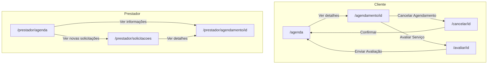
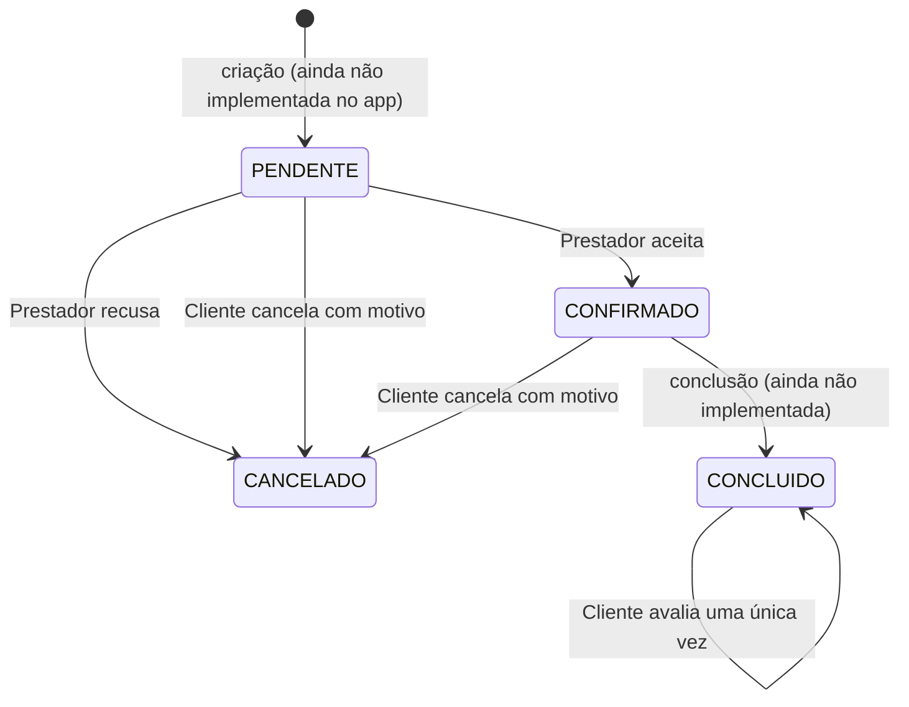

# Agenda — documentação do módulo

> Documentação do módulo de **agendamentos** do app Nesha (front-end Expo + React Native).
> Cobre as telas do **Cliente** e do **Prestador**, o modelo de dados, as regras de negócio já
> implementadas, as limitações atuais e a proposta de integração com o backend.
>
> **Estado atual:** o módulo funciona com **dados mockados em memória** (`src/data/agendamentos.ts`).
> O backend Spring Boot ainda **não** possui entidades nem endpoints de agendamento.

## Sumário

1. [Visão geral](#1-visão-geral)
2. [Telas e rotas](#2-telas-e-rotas)
3. [Ciclo de vida de um agendamento](#3-ciclo-de-vida-de-um-agendamento)
4. [Modelo de dados](#4-modelo-de-dados)
5. [Camada de dados](#5-camada-de-dados)
6. [Detalhamento das telas](#6-detalhamento-das-telas)
7. [Componentes reutilizados](#7-componentes-reutilizados)
8. [Dados mockados e como testar](#8-dados-mockados-e-como-testar)
9. [Acessibilidade atual](#9-acessibilidade-atual)
10. [Limitações conhecidas e pendências](#10-limitações-conhecidas-e-pendências)
11. [Integração com o backend (proposta)](#11-integração-com-o-backend-proposta)
12. [Arquivos do módulo](#12-arquivos-do-módulo)

---

## 1. Visão geral

A agenda permite que:

- o **Cliente** acompanhe seus agendamentos por status (próximos, pendentes, concluídos e cancelados),
  veja os detalhes, copie o telefone do profissional, **cancele** um serviço informando o motivo e
  **avalie** um serviço concluído;
- o **Prestador** veja um painel com calendário semanal e os compromissos do dia, **aceite ou recuse**
  novas solicitações e consulte os detalhes de cada atendimento (incluindo as observações do cliente).

Tecnologias usadas no módulo: Expo Router (rotas por arquivo), React Native, TypeScript,
`@expo/vector-icons` (Ionicons), `expo-clipboard` e `react-native-safe-area-context`.

---

## 2. Telas e rotas

As pastas entre parênteses, como `(app)`, são grupos do Expo Router e **não aparecem na URL**.

| Rota | Arquivo | Perfil | Função |
|---|---|---|---|
| `/agenda` | `app/(app)/agenda.tsx` | Cliente | Lista "Minha Agenda" com filtro por status |
| `/agendamento/[id]` | `app/(app)/agendamento/[id].tsx` | Cliente | Detalhes do agendamento, copiar telefone, botões de cancelar/avaliar |
| `/cancelar/[id]` | `app/(app)/cancelar/[id].tsx` | Cliente | Cancelamento com motivo obrigatório e confirmação |
| `/avaliar/[id]` | `app/(app)/avaliar/[id].tsx` | Cliente | Avaliação com nota, destaques e comentário |
| `/prestador/agenda` | `app/(app)/prestador/agenda.tsx` | Prestador | Painel com calendário semanal, compromissos do dia e filtro por status |
| `/prestador/solicitacoes` | `app/(app)/prestador/solicitacoes.tsx` | Prestador | Novas solicitações: aceitar, recusar ou ver detalhes |
| `/prestador/agendamento/[id]` | `app/(app)/prestador/agendamento/[id].tsx` | Prestador | Detalhes do atendimento e contato do cliente |

### Mapa de navegação



A barra inferior (`BottomNav`) liga **Catálogo** (`/home`), **Agenda** e **Perfil** (`/perfil`).
O destino da aba Agenda é configurável pela prop `agendaHref`: padrão `/agenda` (Cliente) e
`/prestador/agenda` (Prestador).

### Proteção das rotas

Todas as telas ficam dentro do grupo `(app)`, cujo `_layout.tsx` redireciona para `/login` quando
não há sessão. Existe uma chave de desenvolvimento em `src/config/dev.ts`:

```ts
export const PULAR_LOGIN = true; // pula o login e abre direto as telas
```

> ⚠️ **Volte `PULAR_LOGIN` para `false` antes de entregar o projeto.** Enquanto estiver `true`,
> o `app/index.tsx` abre direto em `/agenda` e o guard do `(app)/_layout.tsx` é ignorado.

---

## 3. Ciclo de vida de um agendamento



| Status | Rótulo exibido | Significado |
|---|---|---|
| `PENDENTE` | Pendente | Solicitado pelo cliente, aguardando resposta do prestador |
| `CONFIRMADO` | Confirmado | Prestador aceitou; aparece em "Próximos" (cliente) e "Confirmados" (prestador) |
| `CONCLUIDO` | Concluído | Serviço realizado; pode ser avaliado |
| `CANCELADO` | Cancelado | Cancelado pelo cliente (com motivo) ou recusado pelo prestador |

Quem pode fazer o quê, conforme o código atual:

| Ação | Quem | De → Para | Função |
|---|---|---|---|
| Aceitar solicitação | Prestador | `PENDENTE` → `CONFIRMADO` | `atualizarStatus` |
| Recusar solicitação | Prestador | `PENDENTE` → `CANCELADO` (sem motivo) | `atualizarStatus` |
| Cancelar agendamento | Cliente | `PENDENTE` ou `CONFIRMADO` → `CANCELADO` (com motivo) | `cancelarAgendamento` |
| Avaliar serviço | Cliente | `CONCLUIDO` (grava `avaliacao`) | `avaliarAgendamento` |

---

## 4. Modelo de dados

Definido em `src/data/agendamentos.ts`.

```ts
type StatusAgendamento = 'PENDENTE' | 'CONFIRMADO' | 'CONCLUIDO' | 'CANCELADO';

type Avaliacao = {
  nota: number;          // 1 a 5
  destaques: string[];   // ex.: ['Pontualidade', 'Gentileza']
  comentario: string;    // opcional, até 300 caracteres
};

type Agendamento = {
  id: string;
  status: StatusAgendamento;
  servico: string;
  valor: number;
  prestador: { nome: string; nota: number; avaliacoes: number; telefone: string };
  cliente:   { nome: string; desde: string; telefone: string };
  dia: number;                 // dia do mês (usado no calendário do prestador)
  dataCurta: string;           // "15 Mai"
  dataLonga: string;           // "15 de Maio, Quarta-feira"
  periodo: 'Manhã' | 'Tarde' | 'Noite';
  horarioInicio: string;       // "13:00"
  horario: string;             // "13:00 às 17:00"
  cidade: string;
  regiao: string;              // "Zona Sul"
  endereco: string;            // "Rua das Flores, 123 - Apt 42"
  observacoes?: string;        // escritas pelo cliente, exibidas ao prestador
  motivoCancelamento?: string; // preenchido quando o cliente cancela
  avaliacao?: Avaliacao;       // preenchido após a avaliação
};
```

Observações sobre os campos:

- `dia`, `dataCurta`, `dataLonga`, `periodo`, `horarioInicio` e `horario` são valores **já formatados**
  para exibição. Com o backend, o ideal é receber datas em ISO 8601 e formatar no app (ver seção 11).
- Nas listas, o endereço mostrado no card é só a parte antes de `" - "` (o complemento fica para a tela
  de detalhes): `item.endereco.split(' - ')[0]`.

### Constantes

| Constante | Valores |
|---|---|
| `MOTIVOS_CANCELAMENTO` | Mudança de planos · Encontrei outro profissional · Problema de agenda · Valor acima do esperado · Outro motivo |
| `DESTAQUES_AVALIACAO` | Pontualidade · Qualidade do Trabalho · Gentileza · Organização |
| `STATUS_LABEL` | Mapa `StatusAgendamento` → texto exibido (usado pelo `StatusBadge`) |

---

## 5. Camada de dados

### 5.1 Funções (`src/data/agendamentos.ts`)

Os agendamentos ficam em uma variável de módulo (`let agendamentos`), **sem persistência**: ao recarregar
o app, voltam ao estado inicial. Toda alteração gera uma nova lista (imutabilidade).

| Função | O que faz |
|---|---|
| `listarAgendamentos()` | Retorna uma cópia da lista |
| `buscarAgendamento(id?)` | Retorna um agendamento ou `undefined` |
| `atualizarStatus(id, status)` | Troca o status (usada por aceitar/recusar) |
| `cancelarAgendamento(id, motivo)` | Status `CANCELADO` + `motivoCancelamento` |
| `avaliarAgendamento(id, avaliacao)` | Grava a `avaliacao` |
| `formatarValor(valor)` | `160` → `"R$ 160,00"` |
| `primeiroNome(nome)` | `"Francisco Oliveira"` → `"Francisco"` |

> O comentário no topo do arquivo define o plano de migração: ao integrar o backend, **troque o corpo
> dessas funções por chamadas em `src/services/`**; as telas não precisam mudar (exceto onde as funções
> passarem a ser assíncronas — ver seção 11.4).

### 5.2 Hooks (`src/data/useAgendamentos.ts`)

| Hook | Retorno | Comportamento |
|---|---|---|
| `useAgendamentos()` | `Agendamento[]` | Lê a lista e **recarrega toda vez que a tela volta ao foco** |
| `useAgendamento(id?)` | `Agendamento \| undefined` | Idem, para um único item |

Ambos usam `useFocusEffect` do Expo Router. É por isso que, depois de cancelar ou avaliar em outra tela e
voltar com `router.replace('/agenda')`, a lista aparece atualizada.

---

## 6. Detalhamento das telas

### 6.1 Cliente — Minha Agenda (`/agenda`)

- **Abas** (componente `FilterChips`): `Próximos` (= `CONFIRMADO`), `Pendentes`, `Concluídos`, `Cancelados`.
  A aba inicial é **Próximos**.
- Cada card mostra: status (`StatusBadge`), valor, avatar e nome do prestador, serviço, data curta com o
  período ("15 Mai • Período da Tarde") e local ("Zona Sul, São Paulo • Rua das Flores, 123").
- Cards `CONFIRMADO` têm borda de destaque e um aviso (`Notice`) abaixo:
  *"Lembre-se de deixar as ferramentas no local para o {primeiro nome}."*
- Botão **Ver detalhes** → `/agendamento/[id]`.
- Lista vazia: *"Nenhum agendamento por aqui."*

### 6.2 Cliente — Detalhes (`/agendamento/[id]`)

- **Cartão de status** com bolinha colorida, título e subtítulo que dependem do status:

  | Status | Título | Subtítulo |
  |---|---|---|
  | `CONFIRMADO` | Agendamento Confirmado | O jardineiro {nome} confirmou o horário. |
  | `PENDENTE` | Aguardando confirmação | Esperando {nome} confirmar o horário. |
  | `CONCLUIDO` | Serviço Concluído | {nome} finalizou o serviço. |
  | `CANCELADO` | Agendamento Cancelado | Motivo informado, ou "Este serviço foi cancelado." |

- **Profissional**: avatar, nome e nota com número de avaliações.
- **Resumo do Serviço**: serviço, data, horário (com período), região, endereço completo e valor total.
- **Contato do Profissional**: telefone e botão **Copiar telefone** (usa `expo-clipboard`; o botão muda para
  "Telefone copiado!" por 2 segundos).
- **Ações por status**:
  - `CONFIRMADO` ou `PENDENTE` → botão **Cancelar Agendamento** (vai para `/cancelar/[id]`);
  - `CONCLUIDO` → botão **Avaliar Serviço**; se já houver avaliação, fica desabilitado com o texto
    **Serviço já avaliado**.
- Id inexistente: *"Agendamento não encontrado."*

### 6.3 Cliente — Cancelar (`/cancelar/[id]`)

1. Aviso sobre o motivo do cancelamento e resumo do serviço (avatar, serviço, prestador, valor).
2. Seletor de motivo (lista suspensa com `MOTIVOS_CANCELAMENTO`).
3. Aviso de que o **reembolso pode ocorrer em até 30 dias**, dependendo do método de pagamento.
4. **Confirmar Cancelamento**:
   - sem motivo → `Alert` "Selecione um motivo";
   - com motivo → `Alert` "Cancelar serviço? Essa ação não pode ser desfeita." (Voltar / Confirmar);
   - ao confirmar: `cancelarAgendamento(id, motivo)` e `router.replace('/agenda')`.

### 6.4 Cliente — Avaliar (`/avaliar/[id]`)

- **Nota** de 1 a 5 estrelas (padrão **5**), com rótulo: 1 Péssimo · 2 Ruim · 3 Regular · 4 Muito bom · 5 Excelente.
- **Destaques**: seleção múltipla entre `DESTAQUES_AVALIACAO`.
- **Comentário** opcional, multilinha, limite de **300 caracteres**.
- **Enviar Avaliação**: `avaliarAgendamento(...)` (o comentário é salvo com `trim()`), `Alert`
  "Obrigado! Sua avaliação foi enviada." e retorno para `/agenda`.
- Usa `KeyboardAvoidingView` (iOS) e `keyboardShouldPersistTaps="handled"`.

### 6.5 Prestador — Painel de Agendamentos (`/prestador/agenda`)

- **Abas**: `Confirmados` (inicial), `Solicitados` (= `PENDENTE`) e `Concluídos`. Não há aba de cancelados.
- Botão **Ver novas solicitações** → `/prestador/solicitacoes`.
- **Aba Confirmados**:
  - cartão de calendário com o mês, o botão **Hoje** e a semana (S T Q Q S, dias 13 a 17);
  - tocar em um dia seleciona-o; a seção **Compromissos do Dia** lista os agendamentos `CONFIRMADO`
    cujo `dia` é o dia selecionado (vazio: *"Nenhum compromisso neste dia."*);
  - cada compromisso mostra horário de início, período, status, cliente, serviço, valor e local, com os
    botões **Ver rota no mapa** (ainda sem ação) e **Ver informações** (→ `/prestador/agendamento/[id]`).
- **Demais abas**: cards com status, valor, cliente, serviço, data/horário e botão **Ver informações**
  (vazio: *"Nada por aqui ainda."*).
- Os valores do calendário são constantes no arquivo: `MES = 'Maio 2026'`, `HOJE = 15` e o vetor `SEMANA`.

### 6.6 Prestador — Novas Solicitações (`/prestador/solicitacoes`)

- Lista os agendamentos `PENDENTE`. O contador usa singular/plural:
  *"Nenhuma proposta pendente"*, *"1 nova proposta pendente"*, *"N novas propostas pendentes"*.
- Cada card tem o selo **Nova solicitação**, valor, cliente, serviço, data/horário e cidade/região.
- Ações:
  - **Recusar** → `atualizarStatus(id, 'CANCELADO')`;
  - **Aceitar** → `atualizarStatus(id, 'CONFIRMADO')`;
  - **Ver detalhes** → `/prestador/agendamento/[id]`.
- Depois de aceitar/recusar, a tela faz `router.replace('/prestador/solicitacoes')` para recarregar a lista.
  O link **Recarregar** faz o mesmo.

### 6.7 Prestador — Detalhes (`/prestador/agendamento/[id]`)

- Cartão de status com texto próprio do prestador (ex.: *"Serviço confirmado para atendimento no endereço
  do cliente."*; para `PENDENTE`, orienta a aceitar ou recusar na tela de solicitações).
- Dados do cliente: nome e "Cliente Nesha desde {ano}".
- Resumo: serviço, cidade, região, endereço, data, horário, **Observações do Cliente** (quando existirem) e
  valor total.
- **Contato**: telefone do cliente com botão **Copiar telefone**.
- Esta tela é somente leitura (não há botões de ação).

---

## 7. Componentes reutilizados

Todos em `src/components/`.

| Componente | Uso na agenda |
|---|---|
| `Card` | Contêiner branco com borda e cantos arredondados |
| `Button` | Variantes `primary`, `outline` e `danger`; props `icon`, `loading`, `disabled`, `compact` |
| `StatusBadge` | Selo colorido por status; aceita `label` para sobrescrever o texto |
| `FilterChips` | Abas horizontais genéricas (`<T extends string>`) |
| `IconLine` / `SummaryRow` | Linha "ícone + texto" e linha "rótulo / valor" (`stacked` coloca o valor abaixo) |
| `Notice` | Aviso com tom `warning` ou `error` e ícone opcional |
| `Avatar` | Iniciais do nome (ou foto, se `uri` for informada) |
| `ScreenHeader` | Cabeçalho centralizado com botão de voltar |
| `BottomNav` | Navegação inferior: Catálogo, Agenda e Perfil |

Cores e tokens visuais ficam em `src/theme/colors.ts`.

---

## 8. Dados mockados e como testar

### Registros iniciais

| id | Status | Serviço | Dia | Horário |
|---|---|---|---|---|
| `ag-1` | `CONFIRMADO` | Manutenção de Jardim | 15 (Qua) | 13:00 às 17:00 |
| `ag-2` | `PENDENTE` | Manutenção de Jardim | 15 (Qua) | 13:00 às 17:00 |
| `ag-3` | `CONCLUIDO` | Manutenção de Jardim | 2 (Qui) | 08:00 às 12:00 |

Cliente: Mariana Oliveira · Prestador: Francisco Oliveira. Não há registro inicial `CANCELADO`.

### Rodando

```bash
npm install
npx expo install expo-clipboard   # ver pendência na seção 10
npx expo start
```

### Roteiro de teste manual

**Cliente**
1. Abra `/agenda`: confira as quatro abas e o aviso das ferramentas no card confirmado.
2. Em **Pendentes**, abra o detalhe de `ag-2` e cancele com um motivo; ele deve aparecer em **Cancelados**
   com o motivo no cartão de status.
3. Em **Concluídos**, abra `ag-3` → **Avaliar Serviço** → envie; ao voltar, o botão deve mostrar
   **Serviço já avaliado**.
4. Teste **Copiar telefone** e a tentativa de confirmar o cancelamento sem escolher motivo.

**Prestador**
1. Abra `/prestador/agenda` (ver abaixo como chegar). Selecione os dias 13 a 17 e confira **Compromissos do Dia**.
2. Vá em **Ver novas solicitações**, aceite `ag-2` e confirme que ele passa a aparecer em **Confirmados**
   (dia 15).
3. Recuse uma solicitação e confira que o cliente a vê em **Cancelados**.

### Como abrir a agenda do prestador

Hoje **não há navegação baseada em perfil**: depois do login, qualquer usuário vai para `/home`, e nada no
app leva a `/prestador/agenda`. Para ver essa tela em desenvolvimento, altere o destino em `app/index.tsx`
(há um comentário indicando a troca de `'/agenda'` por `'/prestador/agenda'`) ou abra a rota diretamente.

---

## 9. Acessibilidade atual

Já existe:

- `accessibilityLabel="Voltar"` no botão do `ScreenHeader`;
- `accessibilityLabel="Nota N"` em cada estrela da avaliação;
- `hitSlop` ampliando a área de toque do botão de voltar e das estrelas;
- o status **nunca depende só da cor**: além da cor do selo, o texto do status está sempre presente.

Ainda não existe (pontos de melhoria): `accessibilityRole`/`accessibilityState` nos chips de filtro, nos dias do
calendário, no seletor de motivo e nas tags de destaque; rótulos descritivos nos cards (ex.: "Agendamento de
15 de maio, confirmado, R$ 160,00"); `accessibilityLabel` nos botões da `BottomNav`; e anúncio para leitores de
tela quando o telefone é copiado.

---

## 10. Limitações conhecidas e pendências

**Funcionais**

| # | Item | Detalhe |
|---|---|---|
| 1 | Sem persistência | Os dados vivem em memória; fechar o app reinicia tudo |
| 2 | Sem criação de agendamento | Nenhuma tela cria um agendamento; o fluxo `[*] → PENDENTE` depende do catálogo/contratação |
| 3 | Sem conclusão do serviço | Nenhuma tela faz a transição `CONFIRMADO` → `CONCLUIDO` |
| 4 | Calendário fixo | Mês, "hoje" e semana são constantes (`Maio 2026`, dia 15, dias 13–17); sem navegar entre semanas/meses |
| 5 | Filtro só por dia do mês | `dia` é um número, sem mês e ano; agendamentos de meses diferentes colidiriam |
| 6 | "Ver rota no mapa" | O botão existe, mas `onPress` está vazio |
| 7 | Sem checagem de conflito | `ag-1` e `ag-2` têm o mesmo dia e horário; o prestador consegue aceitar os dois |
| 8 | Recusa sem motivo | Ao recusar, o cliente vê só "Este serviço foi cancelado." |
| 9 | Sem tratamento de carregamento/erro | As telas não têm estados de loading nem de falha de rede (hoje não são necessários) |
| 10 | Sem navegação por perfil | Ver seção 8 |

**Técnicas**

| # | Item | Detalhe |
|---|---|---|
| 1 | `expo-clipboard` fora do `package.json` | É importado em `agendamento/[id].tsx` e `prestador/agendamento/[id].tsx`, mas **não consta** nas dependências nem no `package-lock.json`. Rode `npx expo install expo-clipboard` e faça commit do `package.json` e do lock atualizados, senão o app quebra ao abrir essas telas em outra máquina |
| 2 | `PULAR_LOGIN = true` | Chave de desenvolvimento; voltar para `false` antes da entrega |
| 3 | Duplicação | `DOT` (cor da bolinha por status) está repetido nas duas telas de detalhes; candidato a virar constante compartilhada ou parte do `StatusBadge` |
| 4 | Tabelas de texto por status | O mapa de títulos/subtítulos é montado dentro do componente do cliente e fora dele no do prestador |

---

## 11. Integração com o backend (proposta)

> Proposta do front-end, no mesmo espírito do `docs/API.md`: o backend deve confirmar ou ajustar. Se algo
> mudar, atualize este arquivo, o `docs/API.md` e os tipos do app.

Convenções herdadas do `docs/API.md`: base `{HOST}/api/v1`, JSON em `camelCase` e em português, header
`Authorization: Bearer <accessToken>`, IDs como string e corpo de erro padrão
(`codigo`, `mensagem`, `campos`). O perfil (`CLIENTE` ou `PRESTADOR`) vem do token; o backend deve devolver
**apenas** os agendamentos do usuário logado.

### 11.1 Endpoints sugeridos

| Método | Rota | Perfil | Uso no app |
|---|---|---|---|
| GET | `/agendamentos?status=` | Ambos | Listas do cliente e do prestador |
| GET | `/agendamentos/{id}` | Ambos | Telas de detalhes |
| GET | `/prestador/agenda?de=&ate=` | Prestador | Calendário e compromissos do dia (datas `YYYY-MM-DD`) |
| POST | `/agendamentos/{id}/cancelar` | Cliente | Cancelamento com motivo |
| POST | `/agendamentos/{id}/avaliacao` | Cliente | Avaliação do serviço |
| POST | `/agendamentos/{id}/aceitar` | Prestador | Aceitar solicitação |
| POST | `/agendamentos/{id}/recusar` | Prestador | Recusar solicitação (motivo opcional) |
| POST | `/agendamentos/{id}/concluir` | Prestador | Marcar como concluído |

**Exemplo — `GET /agendamentos/{id}` (`200 OK`)**

```json
{
  "id": "ag-1",
  "status": "CONFIRMADO",
  "servico": "Manutenção de Jardim",
  "valor": 160.0,
  "inicio": "2026-05-15T13:00:00-03:00",
  "fim": "2026-05-15T17:00:00-03:00",
  "prestador": { "id": "…", "nome": "Francisco Oliveira", "nota": 4.9, "avaliacoes": 82, "telefone": "11987654321" },
  "cliente":   { "id": "…", "nome": "Mariana Oliveira", "desde": "2023", "telefone": "11976543210" },
  "endereco": {
    "cep": "04000000", "logradouro": "Rua das Flores", "numero": "123",
    "complemento": "Apt 42", "bairro": "Vila Mariana", "cidade": "São Paulo", "uf": "SP", "regiao": "Zona Sul"
  },
  "observacoes": "Portão azul, tocar o interfone do apartamento 42.",
  "motivoCancelamento": null,
  "avaliacao": null
}
```

**Exemplo — `POST /agendamentos/{id}/cancelar`**

```json
{ "motivo": "Mudança de planos" }
```

**Exemplo — `POST /agendamentos/{id}/avaliacao`**

```json
{ "nota": 5, "destaques": ["Pontualidade", "Gentileza"], "comentario": "Ótimo trabalho!" }
```

### 11.2 Regras que o backend deve garantir

- **Transições válidas** (seção 3): qualquer outra deve ser recusada com `409 TRANSICAO_INVALIDA`.
- **Autorização:** cliente só mexe nos próprios agendamentos e prestador só nos atribuídos a ele (`403`/`404`).
- **Cancelamento:** `motivo` obrigatório, vindo de `MOTIVOS_CANCELAMENTO`; só em `PENDENTE` ou `CONFIRMADO`.
- **Avaliação:** só em `CONCLUIDO`; `nota` de 1 a 5; `comentario` até 300 caracteres; **uma única** avaliação
  por agendamento (`409 AVALIACAO_JA_ENVIADA`). O backend também deve atualizar `nota` e `avaliacoes` do prestador.
- **Conflito de horário:** impedir que o prestador aceite dois agendamentos sobrepostos.
- **Datas:** trafegar `inicio` e `fim` em ISO 8601. O app deriva `dia`, `dataCurta`, `dataLonga`, `periodo`,
  `horarioInicio` e `horario` a partir deles.
- **Telefone:** somente dígitos (o app aplica a máscara), como no restante da API.

### 11.3 Códigos de erro novos

| HTTP | `codigo` | Quando |
|---|---|---|
| 403 | `ACESSO_NEGADO` | O agendamento não pertence ao usuário |
| 404 | `AGENDAMENTO_NAO_ENCONTRADO` | Id inexistente |
| 409 | `TRANSICAO_INVALIDA` | Mudança de status não permitida |
| 409 | `AVALIACAO_JA_ENVIADA` | Agendamento já avaliado |
| 409 | `CONFLITO_DE_HORARIO` | Prestador já tem compromisso no período |

### 11.4 Como migrar o app

1. Criar `src/types/agendamento.ts` e `src/services/agendamentos.ts` (usando `request` de `src/services/api.ts`),
   seguindo o padrão de `src/services/auth.ts`, inclusive o modo simulado (`EXPO_PUBLIC_USE_MOCK`).
2. Trocar o corpo das funções de `src/data/agendamentos.ts` pelas chamadas HTTP. Elas passam a ser
   **assíncronas**: `useAgendamentos` e `useAgendamento` devem tratar `loading` e erro, e as telas de cancelar,
   avaliar e solicitações devem aguardar (`await`) a resposta antes de navegar e exibir o erro retornado
   (`ApiError.mensagem`).
3. Substituir as constantes de calendário (`MES`, `HOJE`, `SEMANA`) por cálculo com a data real e buscar
   `/prestador/agenda` pelo intervalo visível.
4. Implementar "Ver rota no mapa" (por exemplo, abrindo o endereço no app de mapas com `Linking`).
5. Atualizar `docs/API.md` (tabela de endpoints e códigos de erro) com o que for aprovado.

---

## 12. Arquivos do módulo

```text
nesha-main/
├── app/
│   └── (app)/
│       ├── agenda.tsx                       # Cliente: Minha Agenda
│       ├── agendamento/[id].tsx             # Cliente: detalhes
│       ├── cancelar/[id].tsx                # Cliente: cancelamento
│       ├── avaliar/[id].tsx                 # Cliente: avaliação
│       └── prestador/
│           ├── agenda.tsx                   # Prestador: painel e calendário
│           ├── solicitacoes.tsx             # Prestador: aceitar/recusar
│           └── agendamento/[id].tsx         # Prestador: detalhes
├── src/
│   ├── data/
│   │   ├── agendamentos.ts                  # Tipos, mocks, regras e formatadores
│   │   └── useAgendamentos.ts               # Hooks com recarga ao ganhar foco
│   ├── components/
│   │   ├── BottomNav.tsx
│   │   ├── FilterChips.tsx
│   │   ├── StatusBadge.tsx
│   │   ├── InfoRow.tsx                      # IconLine e SummaryRow
│   │   ├── Notice.tsx
│   │   ├── Card.tsx
│   │   ├── Button.tsx
│   │   ├── Avatar.tsx
│   │   └── ScreenHeader.tsx
│   ├── theme/colors.ts
│   └── config/dev.ts                        # PULAR_LOGIN
└── docs/
    ├── API.md                               # Contrato app ↔ backend (auth)
    └── AGENDA.md                            # Este documento
```
